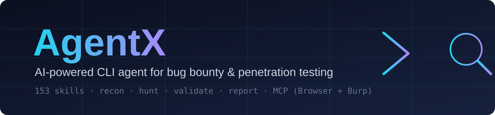
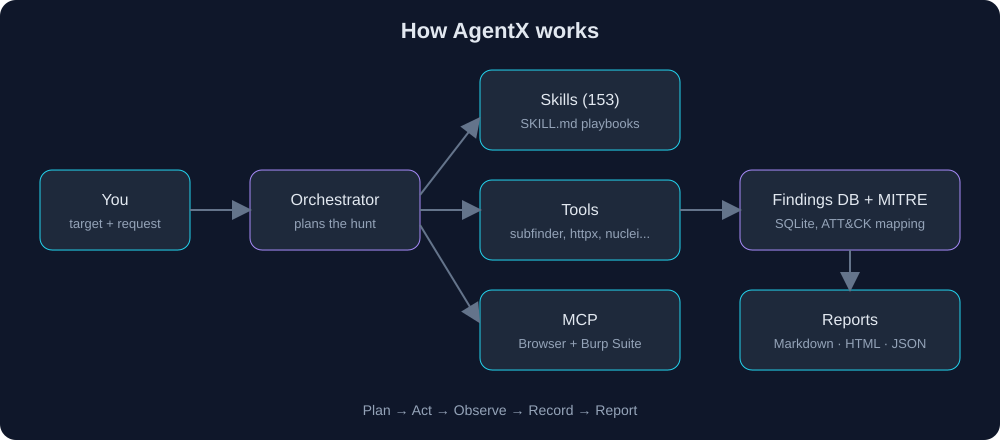
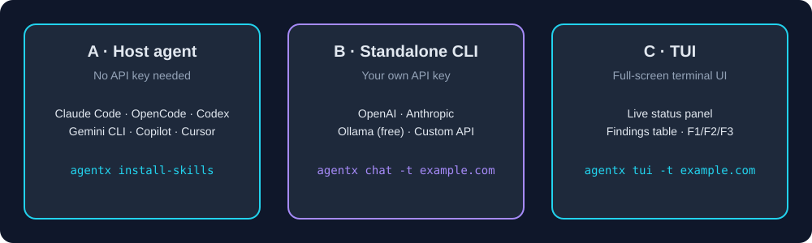
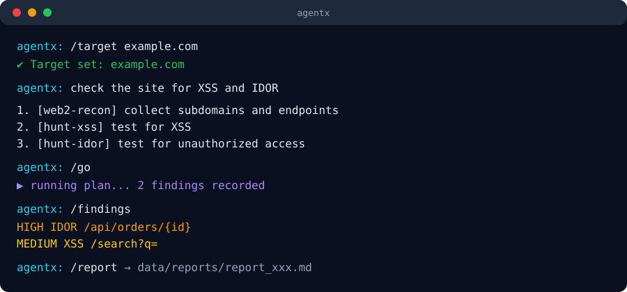
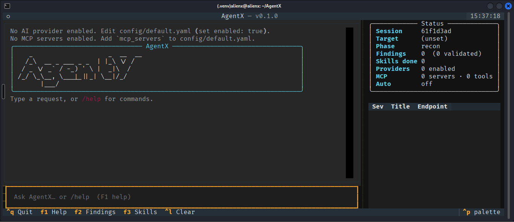

<p align="center">
  
</p>

<p align="center">
  
  
  
  
</p>

# AgentX

**An AI-powered CLI agent for bug bounty hunting and penetration testing.**

AgentX builds multi-step hunt plans, runs vulnerability playbooks and your local tools, stores every finding, and exports professional reports as Markdown, HTML, or JSON.

> ⚠️ For **authorized targets only**. Always verify results manually before submitting.

---

## Table of Contents

1. [How it works](#how-it-works)
2. [Features](#features)
3. [Installation](#installation)
4. [Ways to use AgentX](#ways-to-use-agentx)
   - [A. Install skills into your LLM agent (no API key)](#a-install-skills-into-your-llm-agent-no-api-key)
   - [B. Run AgentX as a standalone agent (API key)](#b-run-agentx-as-a-standalone-agent-api-key)
   - [C. Use the TUI](#c-use-the-tui)
5. [MCP: Browser and Burp Suite](#mcp-browser-and-burp-suite)
6. [Commands reference](#commands-reference)
7. [Skills, tools and reports](#skills-tools-and-reports)
8. [Troubleshooting](#troubleshooting)
9. [Disclaimer](#disclaimer)

---

## How it works

AgentX has two independent halves. You can use either one on its own, or both together.

| Part | Folder | What it is |
|------|--------|------------|
| **Skills** | `skills/` | 153 Markdown playbooks (`SKILL.md`) covering recon, hunting, validation and reporting. |
| **Runtime** | `agentx/` | The agent itself: orchestrator, planner, executor, memory, findings database, MITRE mapping, MCP client and reporting. |

<p align="center">
  
</p>

**The loop:** you give a target and a request → the orchestrator builds a plan → each step runs a skill, a local tool, or an MCP tool → results are observed, validated and stored → you export a report.

---

## Features

- **Multi-step hunt planning** from a plain-English request.
- **153 skill playbooks**: recon, XSS, SQLi, SSRF, IDOR, RCE, auth bypass, JWT, OAuth, GraphQL, race conditions, cloud misconfig, CI/CD, and more.
- **Works with any LLM**: OpenAI, Anthropic, Ollama (free, local), LM Studio, or any OpenAI-compatible API.
- **Works without an API key** by installing the skills into the agent you already use.
- **MCP tool access**: drives a real browser (Playwright) and Burp Suite.
- **Permission gate** for every state-changing action (`ask` / `auto` / `yolo`).
- **Findings database** with severity, endpoint, impact, reproduction steps and evidence.
- **MITRE ATT&CK mapping** on skills, findings, plans and reports.
- **Full-screen TUI** with a live status panel and findings table.
- **Session handoff** (`/handoff`) to continue work in a fresh context.
- **Reports** in Markdown, HTML or JSON.

---

## Installation

**Requirements**

- Python **3.11+** and **pip**
- An AI provider (**only for Option B/C**): OpenAI, Anthropic, Ollama, or any OpenAI-compatible API
- *Optional:* **Git** and **Go** (to auto-install external tools), **Node.js ≥ 20** (for the browser MCP)

**Install**

```powershell
cd C:\Users\KTS\Documents\agent\AgentX
python -m venv .venv

.\.venv\Scripts\Activate.ps1        # Windows PowerShell
 source .venv/bin/activate         # Linux / macOS
 .venv\Scripts\activate.bat        # Windows CMD

pip install -e .                    # installs AgentX + all dependencies
agentx --version                    # should print "AgentX v0.1.0"
agentx config --init                # creates config/default.yaml
agentx skills                       # lists the 153 bundled skills
```

> If PowerShell blocks the activation script, run once:
> `Set-ExecutionPolicy -Scope CurrentUser -ExecutionPolicy RemoteSigned`

**Health check**

```powershell
agentx --version; agentx config --show; agentx skills; agentx tools --check
```

---

## Ways to use AgentX

<p align="center">
  
</p>

| | A. Host agent | B. Standalone CLI | C. TUI |
|---|---|---|---|
| **Who is the LLM** | Your existing agent | AgentX via API / Ollama | AgentX via API / Ollama |
| **API key** | Not needed | Required (or Ollama) | Required (or Ollama) |
| **Installs** | `SKILL.md` playbooks | nothing, just run `agentx` | nothing, just run `agentx tui` |
| **Best for** | Reusing Claude Code, OpenCode, etc. | Scripted / terminal workflows | Interactive hunting with live view |

### A. Install skills into your LLM agent (no API key)

Skills are plain `SKILL.md` files in the open [Agent Skills](https://agentskills.io) format, so any agent that supports it can use them directly. AgentX just copies them into place.

```powershell
agentx install-skills --list        # show known locations and which were detected
agentx install-skills --dry-run     # preview what would be created / updated
agentx install-skills               # install into every agent detected on this machine
```

Standalone script (no `agentx` entry point needed):

```powershell
python scripts\install_to_agents.py --list
python scripts\install_to_agents.py --all
```

**Supported agents (user scope)**

| Key | Agent | Path |
|-----|-------|------|
| `universal` | Any agent on the standard | `~/.agents/skills` |
| `claude` | Claude Code | `~/.claude/skills` |
| `opencode` | OpenCode | `~/.config/opencode/skills` |
| `gemini` | Gemini CLI | `~/.gemini/skills` |
| `copilot` | GitHub Copilot CLI | `~/.copilot/skills` |
| `cursor` | Cursor | `~/.cursor/skills` |

**Useful flags**

| Flag | Effect |
|------|--------|
| `--target claude` | Install to one agent (repeatable), or pass a custom path |
| `--only hunt-xss,hunt-ssrf` | Install a subset of skills |
| `--project` | Also install project-scoped copies (`.claude/skills`, `.agents/skills`, …) so they can be committed with a repo |
| `--keep` | Leave existing skill folders untouched |
| `--dry-run` | Preview only |

Installs are idempotent copies. Nothing is ever deleted.

**After installing:** restart your agent and check its skills list (`/skills` in Claude Code and OpenCode, `/skills list` in Gemini CLI, Customize → Skills in Cursor). The agent now routes to `hunt-xss`, `sast-sqli`, `osint-methodology` and the rest, with no key and no extra process.

### B. Run AgentX as a standalone agent (API key)

**1. Enable one provider** in `config/default.yaml`. All providers are disabled by default.

```powershell
setx OPENAI_API_KEY "sk-..."        # then reopen the terminal
```

```yaml
ai_providers:
  - name: "openai"      # type: openai | anthropic | ollama | lmstudio | custom
    type: "openai"
    api_key: "${OPENAI_API_KEY}"
    base_url: "https://api.openai.com/v1"
    model: "gpt-4o"
    enabled: true
```

| Provider | `base_url` | Example model | Key variable |
|----------|-----------|---------------|--------------|
| OpenAI | `https://api.openai.com/v1` | `gpt-4o` | `OPENAI_API_KEY` |
| Anthropic | `https://api.anthropic.com` | `claude-3-5-sonnet-20241022` | `ANTHROPIC_API_KEY` |
| Ollama | `http://localhost:11434` | `llama3.1:8b` | *(none, free)* |
| Custom | your OpenAI-compatible URL | your model | your key |

**2. Set model routing.** Names must match an enabled provider's `model`.

```yaml
orchestrator_model: "gpt-4o"        # strong model for planning
skill_model: "gpt-4o-mini"          # fast model for execution
local_model: "llama3.1:8b"          # local tasks
```

**3. Verify:** `agentx config --show` (enabled provider count must be greater than 0).

**4. Run**

```powershell
agentx                                   # interactive chat
agentx chat --target example.com --auto  # chat with a target, auto mode
agentx recon example.com --stages subdomains,http_probe,urls,fingerprint
agentx scan  example.com --request "focus on IDOR in the API"
agentx report --format markdown --output report.md
```

**Example session**

<p align="center">
  
</p>


### C. Use the TUI

```powershell
agentx tui --target example.com
agentx tui --target example.com --auto
```

The TUI has the same slash commands in a full-screen layout, with a live status panel and a findings table.

| Key | Action |
|-----|--------|
| `F1` | Help |
| `F2` | Findings |
| `F3` | Skills |
| `Ctrl+L` | Clear |
| `Ctrl+Q` | Quit |




---

## MCP: Browser and Burp Suite

AgentX can act like a real agent and **drive tools itself** through the [Model Context Protocol](https://modelcontextprotocol.io). When it needs to see a page it opens a browser, and it sends raw requests through Burp Suite. Both are disabled by default.

```yaml
mcp_servers:
  - name: "browser"          # Playwright MCP - needs Node.js >= 20
    transport: "stdio"
    command: "npx"
    args: ["-y", "@playwright/mcp@latest", "--headless"]
    enabled: true

  - name: "burp"             # PortSwigger "MCP Server" BApp in Burp Suite
    transport: "sse"
    url: "http://127.0.0.1:9876"
    enabled: true
```

### Browser (Playwright)

1. Install **Node.js ≥ 20**.
2. Set `enabled: true` for the `browser` server in `config/default.yaml`.
3. Start AgentX. The first run downloads the Playwright MCP via `npx`.

### Burp Suite

1. In Burp: **Extensions → BApp Store → install "MCP Server"**.
2. Open the extension's tab and enable **SSE** on `127.0.0.1:9876` (click start).
3. Set `enabled: true` for the `burp` server in `config/default.yaml`.

### What you get

When MCP servers are connected, normal chat turns become a **plan → act → observe loop**: the model picks a tool, runs it, reads the result, and continues until it has an answer.

- `browser.*` tools show live pages and snapshots.
- `burp.*` tools send requests and inspect proxy history.
- Check everything connected with `/mcp`.
- Limit tool-call rounds per turn with `max_agent_steps`.

### Permission gate

By default (`permission_mode: "ask"`) every state-changing call (sending a request, clicking, typing) asks for your approval. Change it at runtime with `/mode`.

| Mode | Behaviour |
|------|-----------|
| `ask` | Prompts for state-changing tools, auto-runs reads *(default)* |
| `auto` | Never prompts. For scripted runs |
| `yolo` | Never prompts and runs state-changing tools without review. Use with care |

Pre-approve tools in config with `auto_approve: true` on a server, or `mcp_auto_approve: ["browser.navigate"]`.

---

## Commands reference

| Command | Purpose | Key options |
|---------|---------|-------------|
| `agentx` / `chat` | Interactive chat | `--target/-t`, `--auto` |
| `agentx tui` | Full-screen terminal UI | `--target/-t`, `--auto` |
| `agentx recon` | Recon pipeline | `--stages/-s` |
| `agentx scan` | Recon + plan + hunt | `--request/-r`, `--auto/--no-auto` |
| `agentx report` | Export findings | `--format/-f`, `--output/-o`, `--session/-s` |
| `agentx skills` | List / inspect skills | `list`, `info <name>` |
| `agentx attack` | MITRE ATT&CK coverage / lookup | `[TECHNIQUE]`, `--skill`, `--tactic`, `--search` |
| `agentx install-skills` | Install skills into a host agent | `--list`, `--target`, `--all`, `--project`, `--only`, `--dry-run`, `--force/--keep` |
| `agentx tools` | Check / install tools | `--check`, `--missing`, `--install`, `--install-all` |
| `agentx config` | Show / init config | `--show`, `--init` |
| `agentx sessions` | List past sessions | |

**In-chat slash commands**

`/help` `/target <url|domain>` `/status` `/skills [filter]` `/plan <request>` `/go` `/findings [severity]` `/validate` `/report [format]` `/recon [stages]` `/mcp` `/mode ask|auto|yolo` `/auto on|off` `/sessions` `/handoff` `/clear` `/exit`

`/handoff` prints a Markdown handoff report (findings by severity, captured credentials with secrets masked, attack chains, next steps) so you can continue in a fresh context.

---

## Skills, tools and reports

- **Skills:** Markdown playbooks in `skills/<name>/SKILL.md`, discovered automatically. Core set:
  - Recon: `web2-recon`, `offensive-osint`
  - Hunting: `hunt-xss`, `hunt-sqli`, `hunt-ssrf`, `hunt-idor`, `hunt-rce`, `hunt-auth-bypass`, `hunt-jwt-crypto`, `hunt-mfa-bypass`, `hunt-session`, `hunt-oauth`, `hunt-graphql`, `hunt-api-misconfig`, `hunt-websocket`, `hunt-business-logic`, `hunt-race-condition`, `hunt-cloud-misconfig`, `hunt-cicd`, `hunt-source-leak`, `hunt-spa-api`, `hunt-shadow-api`
  - Process: `triage-validation`, `evidence-hygiene`, `bb-methodology`, `bug-bounty`, `security-arsenal`
  - Add your own by creating `skills/my-skill/SKILL.md`.
- **Tools:** optional open-source helpers (`subfinder`, `httpx`, `nuclei`, `ffuf`, `katana`, `gau`, `dalfox`, `sqlmap`, …). Auto-install needs Go; otherwise install manually and add to `PATH`. Connect your own scripts with `local_tools` in the config.
- **Reports:** every finding stores title, severity, endpoint, description, impact, reproduction steps and evidence, saved to `data/reports/`.
- **MITRE ATT&CK:** 140 of 153 skills carry a reviewed `mitre_attack:` mapping (process-only skills are intentionally empty). `agentx attack` shows coverage; findings inherit the mapping in chat, plans and reports. Artifacts: `mappings/attack-navigator-layer.json` and `ATTACK_COVERAGE.md`.
- **Skill QA:** validate, lint, de-collide and index skills with `agentx-skill-qa all` (or `python -m agentx.skills.qa all`).

### Project layout

```text
agentx/    cli, config, ai/, core/ (orchestrator, planner, executor, memory, session),
           tui/, skills/, tools/, recon/, reporting/, integrations/
config/    default.yaml          skills/   playbooks + index.json
data/      agentx.db, reports/   scripts/  copy_skills.py, install_to_agents.py   tests/
```

---

## Troubleshooting

| Problem | Fix |
|---------|-----|
| `agentx: command not found` | Activate the venv, or use `python -m agentx` |
| `No AI provider configured` | Set `enabled: true` for one provider |
| `401` / `AuthenticationError` | Check the key variable, then reopen the terminal |
| Model does not respond | Make `orchestrator_model` match the provider's `model` |
| `subfinder not installed` | `agentx tools --install subfinder` |
| `running scripts is disabled` | `Set-ExecutionPolicy -Scope CurrentUser RemoteSigned` |
| No skills show up | Run `agentx skills`, then `agentx install-skills` to push them into your agent |
| Browser MCP does not start | Check `node --version` is 20 or higher |
| Burp MCP not connecting | Make sure the BApp's SSE server is started on `127.0.0.1:9876` |

---

## Disclaimer

Use AgentX only on systems you have **explicit written permission** to test. You are solely responsible for any misuse, and every AI-generated result must be manually verified.
